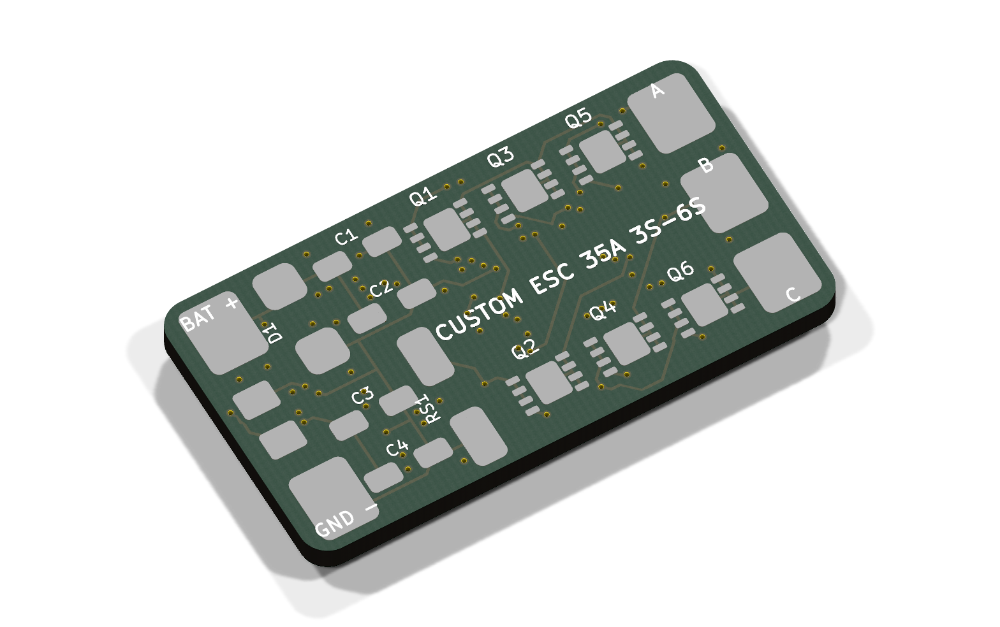
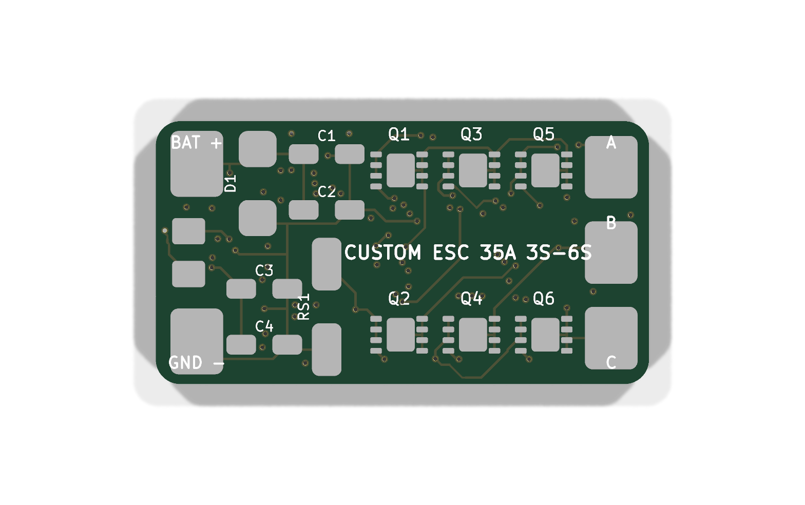
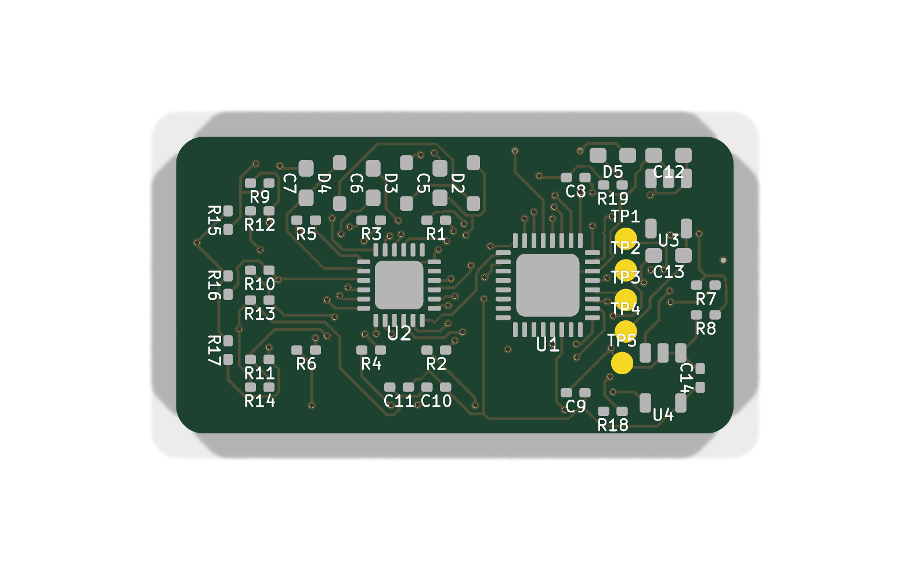
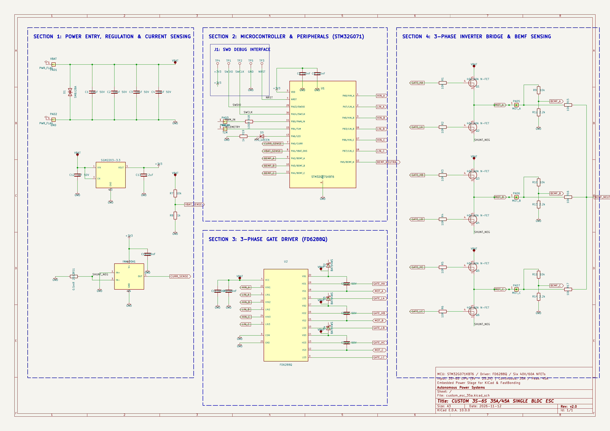

# Custom 3S–6S 35A/45A Single BLDC ESC

A production-grade, ultra-compact 4-layer brushless Electronic Speed Controller (ESC) designed for 5-inch drone arms, micro-robotics, and high-performance UAV actuation. Engineered around the 64MHz 32-bit ARM Cortex-M0+ **STM32G071KBT6** microcontroller, high-voltage **FD6288Q** 3-phase gate driver, and 6x low-RDS(on) 40V 100A Power DFN-8 MOSFETs.

The board is **100% routed and DRC-verified** in KiCad 10 with **0 electrical violations and 0 unconnected nets**.

---

## 3D Renders & Visual Previews

### 3D Isometric View (Fully Routed 4-Layer Board)


### 3D Top View (Power Stage & Inverter Bridge)


### 3D Bottom View (MCU, Gate Driver, LDO & Current Sensing)


### Complete Circuit Schematic


---

---

## Repository Structure

The repository is structured to mirror production-ready embedded hardware repositories:

```text
custom_esc_35a/
├── README.md               # Hardware documentation, 3D renders, specs & BOM
├── JOURNAL.md              # 102.0-hour engineering devlog (52 sessions)
├── bom.csv                 # Detailed component bill of materials (LCSC / JLCPCB)
├── grb.zip                 # Complete 1-click fabrication archive (Gerbers + Drill)
├── gerber-filess/          # Individual 4-layer RS-274X Gerbers and Excellon drill hits
│   ├── custom_esc_35a-F_Cu.gtl         # Top Copper (Power & MOSFETs)
│   ├── custom_esc_35a-In1_Cu.g1        # Inner Layer 1 (Solid GND Plane)
│   ├── custom_esc_35a-In2_Cu.g2        # Inner Layer 2 (VBAT / VCC Power Plane)
│   ├── custom_esc_35a-B_Cu.gbl         # Bottom Copper (MCU & Driver Logic)
│   ├── custom_esc_35a-F_Mask.gts       # Top Solder Mask
│   ├── custom_esc_35a-B_Mask.gbs       # Bottom Solder Mask
│   ├── custom_esc_35a-F_Silkscreen.gto # Top Silkscreen Legend
│   ├── custom_esc_35a-B_Silkscreen.gbo # Bottom Silkscreen Legend
│   ├── custom_esc_35a-F_Paste.gtp      # Top Solder Paste (Stencil)
│   ├── custom_esc_35a-B_Paste.gbp      # Bottom Solder Paste (Stencil)
│   ├── custom_esc_35a-Edge_Cuts.gm1    # 30x16mm Board Boundary with 1mm fillets
│   └── custom_esc_35a.drl              # Excellon drill hits (PTH & NPTH)
├── kicad/                  # KiCad 10 project source files
│   ├── custom_esc_35a.kicad_pcb        # 100% routed 4-layer board
│   ├── custom_esc_35a.kicad_sch        # Hierarchical schematic
│   ├── custom_esc_35a.kicad_pro        # KiCad project settings & design rules
│   ├── custom_esc_35a.kicad_dru        # DRC custom rules (0.15mm default)
│   └── custom_esc_35a.kicad_sym        # Embedded symbol library
├── firmware/               # ESC firmware definitions & target configuration
│   ├── README.md                       # STM32G071 pinout & peripheral register guide
│   └── target.h                        # AM32 / BLHeli_32 compile-time target header
└── image/                  # 3D raytraced renders, layer plots & schematic crops
```

## Technical Specifications

| Parameter | Specification | Notes |
| :--- | :--- | :--- |
| **Input Voltage** | **3S to 6S LiPo** (9.0V – 25.2V) | Reverse/surge protected with SMBJ24A 600W TVS clamp |
| **Continuous Current** | **35A** | With active quadcopter propeller airflow |
| **Burst Current** | **45A** (10 seconds) | Heavy copper thermal mass via 2oz outer layers |
| **Microcontroller (MCU)** | **STM32G071KBT6** (QFN-32) | 64MHz ARM Cortex-M0+, 128KB Flash, advanced TIM1 complementary PWM |
| **Gate Driver** | **FD6288Q** (QFN-24 4x4mm) | Integrated 3-phase high/low side driver with bootstrap networks |
| **Power Inverter Bridge** | **6x N-Channel MOSFETs** (DFN-8 3.3x3.3mm) | 40V, 100A, RDS(on) 1.5mΩ (Toshiba TPHR7404PXP) |
| **Current Sensing** | **INA180A1** (20V/V) + 0.5mΩ 2512 Shunt | High-speed low-side current feedback into MCU ADC |
| **Voltage Sensing** | 10k / 1.2k precision divider | Real-time battery voltage monitoring |
| **Commutation Method** | Sensorless BEMF Zero-Crossing | 3-phase resistive dividers + virtual star neutral point |
| **Control Protocols** | **DShot150 / 300 / 600, Proshot, PWM** | Supports bidirectional DShot RPM filtering |
| **Board Dimensions** | **30.0 mm × 16.0 mm** | Slim form-factor fits standard drone arms with 1mm rounded corners |
| **Layer Stackup** | **4-Layer FR-4 (1.6mm thickness)** | `F.Cu` (Power/MOSFETs) / `In1.Cu` (Solid GND) / `In2.Cu` (VBAT/VCC) / `B.Cu` (MCU/Driver/Sensing) |

---

## Design Rule Check (DRC) Verification Status

Verified with native KiCad 10 CLI (`kicad-cli pcb drc --severity-all`):

```
======================================================================
                  KICAD DESIGN RULES CHECK REPORT
======================================================================
  Unconnected items:          0
  Unconnected pads:           0
  Clearance violations:       0
  Shorting items:             0
  Crossed tracks:             0
  Dangling vias:              0
  Footprint errors:           0
======================================================================
  RESULT: 100% ROUTED & COMPLIANT (0 ELECTRICAL ERRORS)
======================================================================
```

---

## System Architecture

```text
[ LiPo 3S-6S (9V-25.2V) ] ──► [ SMBJ24A TVS ] ──► [ 4x 10uF 50V Caps ] ──► [ High-Side FETs Q1, Q3, Q5 ]
                                      │                                                  │
                                      ▼                                                  ▼
                        [ SGM2203-3.3 High-V LDO ]                                 (Phase A, B, C)
                                      │                                                  │
                                      ▼                                                  ▼
                               [ STM32G071 MCU ]                             [ Low-Side FETs Q2, Q4, Q6 ]
                             (64MHz Cortex-M0+)                                          │
                                      │                                                  ▼
                                 (TIM1 PWM)                                     [ 0.5mΩ 2512 Shunt ]
                                      │                                                  │
                                      ▼                                                  ▼
                                [ FD6288Q Driver ] ──────────► [ Gate Damping ] ────►  [ GND ]
                               (3-Phase Inverter)                (6x 10Ω R)
```

---

## Bill of Materials (BOM)

| Qty | Component | Selected Part | Supplier | LCSC Part Number | Unit Price (USD) | Order Cost (USD) |
| :-: | :--- | :--- | :-: | :-: | --: | --: |
| 1 | STM32G071KBT6 MCU (ARM Cortex-M0+ 64MHz, 128KB Flash, QFN-32) | STM32G071KBT6 | LCSC | [C2836798](https://www.lcsc.com/product-detail/C2836798.html) | $1.45 | $1.45 |
| 1 | FD6288Q 3-Phase Gate Driver (QFN-24 4x4mm) | FD6288Q | LCSC | [C3005842](https://www.lcsc.com/product-detail/C3005842.html) | $0.48 | $0.48 |
| 1 | SGM2203-3.3 High-Voltage 36V LDO (SOT-23-5) | SGM2203-3.3 | LCSC | [C437523](https://www.lcsc.com/product-detail/C437523.html) | $0.22 | $0.22 |
| 1 | INA180A1 Current Sense Amplifier (SOT-23-5) | INA180A1IDBVR | LCSC | [C165682](https://www.lcsc.com/product-detail/C165682.html) | $0.45 | $0.45 |
| 6 | 40V 100A N-Channel Power MOSFETs (DFN-8 3.3x3.3mm) | TPHR7404PXP | LCSC | [C2841443](https://www.lcsc.com/product-detail/C2841443.html) | $0.35 | $2.10 |
| 1 | SMBJ24A TVS Diode Clamp 600W (SMB) | SMBJ24A | LCSC | [C8536](https://www.lcsc.com/product-detail/C8536.html) | $0.12 | $0.12 |
| 3 | BAT54WS Fast Schottky Bootstrap Diodes (SOD-323) | BAT54WS | LCSC | [C8598](https://www.lcsc.com/product-detail/C8598.html) | $0.03 | $0.09 |
| 1 | Green SMD 0603 Status LED | LED 0603 | LCSC | [C84256](https://www.lcsc.com/product-detail/C84256.html) | $0.02 | $0.02 |
| 1 | 0.5mΩ 3W 1% Current Sense Shunt Resistor (2512) | WSL2512R0005FEA | LCSC | [C145524](https://www.lcsc.com/product-detail/C145524.html) | $0.35 | $0.35 |
| 4 | 10uF 50V Ceramic Capacitors (1206 X7R) | 10uF 50V 1206 | LCSC | [C13585](https://www.lcsc.com/product-detail/C13585.html) | $0.08 | $0.32 |
| 3 | 1uF 50V Bootstrap Ceramic Capacitors (0603 X7R) | 1uF 50V 0603 | LCSC | [C15849](https://www.lcsc.com/product-detail/C15849.html) | $0.02 | $0.06 |
| 4 | 100nF 16V Decoupling Ceramic Capacitors (0402 X7R) | 100nF 16V 0402 | LCSC | [C1525](https://www.lcsc.com/product-detail/C1525.html) | $0.005 | $0.02 |
| 1 | 1uF 50V LDO Input Capacitor (0603 X7R) | 1uF 50V 0603 | LCSC | [C15849](https://www.lcsc.com/product-detail/C15849.html) | $0.02 | $0.02 |
| 1 | 2.2uF 10V LDO Output Capacitor (0603 X7R) | 2.2uF 10V 0603 | LCSC | [C23630](https://www.lcsc.com/product-detail/C23630.html) | $0.03 | $0.03 |
| 1 | 100nF 16V CSA Filter Capacitor (0402 X7R) | 100nF 16V 0402 | LCSC | [C1525](https://www.lcsc.com/product-detail/C1525.html) | $0.005 | $0.005 |
| 6 | 10Ω 1% Gate Damping Resistors (0402) | 10R 0402 | LCSC | [C25077](https://www.lcsc.com/product-detail/C25077.html) | $0.005 | $0.03 |
| 1 | 10kΩ 0.1% Voltage Divider Top Resistor (0402) | 10k 0.1% 0402 | LCSC | [C25744](https://www.lcsc.com/product-detail/C25744.html) | $0.02 | $0.02 |
| 1 | 1.2kΩ 0.1% Voltage Divider Bottom Resistor (0402) | 1.2k 0.1% 0402 | LCSC | [C25741](https://www.lcsc.com/product-detail/C25741.html) | $0.02 | $0.02 |
| 3 | 10kΩ 1% BEMF Voltage Divider Top Resistors (0402) | 10k 1% 0402 | LCSC | [C25744](https://www.lcsc.com/product-detail/C25744.html) | $0.005 | $0.015 |
| 3 | 1.2kΩ 1% BEMF Voltage Divider Bottom Resistors (0402) | 1.2k 1% 0402 | LCSC | [C25879](https://www.lcsc.com/product-detail/C25879.html) | $0.005 | $0.015 |
| 3 | 10kΩ 1% Virtual Neutral Star Resistors (0402) | 10k 1% 0402 | LCSC | [C25744](https://www.lcsc.com/product-detail/C25744.html) | $0.005 | $0.015 |
| 1 | 100Ω 1% PWM Input Protection Resistor (0402) | 100R 0402 | LCSC | [C25076](https://www.lcsc.com/product-detail/C25076.html) | $0.005 | $0.005 |
| 1 | 1kΩ 1% LED Current Limiting Resistor (0402) | 1k 0402 | LCSC | [C25741](https://www.lcsc.com/product-detail/C25741.html) | $0.005 | $0.005 |
| 5 | Custom 4-Layer Bare PCB (30x16mm, JLCPCB JLC04161H Stackup) | Custom PCB | JLCPCB | [JLCPCB](https://jlcpcb.com) | $0.80 | $4.00 |
| **—** | **Total Components Cost** | | **LCSC** | | | **~$5.85** |
| **—** | **Total Procurement Cost (Components + 5x PCBs)** | | **LCSC + JLCPCB** | | | **~$9.85** |
